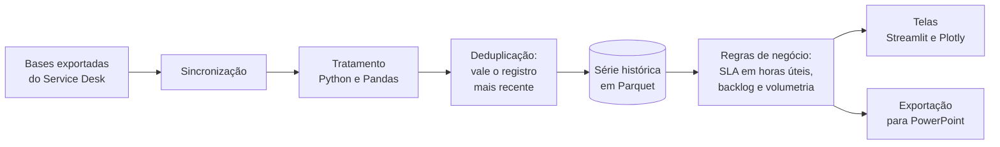

# Analytics RH

Estudo de caso da plataforma web que concebi e construí, por iniciativa própria, para acompanhar um contrato de sustentação de RH e folha de pagamento. Ela está em produção desde março de 2026 e funciona todos os dias no acompanhamento do contrato.

> Este repositório mostra o problema, as decisões, a arquitetura e o método de entrega. Ele não traz o código nem dados do contrato.

## O problema

O acompanhamento do contrato vivia em planilhas e relatórios montados à mão. Cada relatório repetia o mesmo tratamento das bases exportadas do Service Desk, e duas pessoas podiam chegar a números diferentes para a mesma pergunta: quantos chamados estão abertos, quantos passaram do prazo, como o backlog andou na semana.

Para quem acompanha um contrato de serviço, isso custa duas vezes: o tempo de montar e a confiança no número.

## O que a plataforma faz

- Painel BI dos escopos N2 e N3: abertos e resolvidos, backlog, SLA e ciclos contratuais, com exportação para PowerPoint.
- Consulta histórica, com recorte de período.
- Roadmap das evolutivas, com gráfico de Gantt e painel de acompanhamento.
- Gestão técnica, com quadro de chamados por consultor e apontamento de atividades.
- Visão geral com a volumetria de chamados dos dois escopos.

## Como os dados andam

## Decisões que sustentam o número

Cada regra mora num lugar só. O cálculo de SLA, a contagem em horas úteis e a deduplicação ficam numa camada própria, coberta por testes. As telas só leem o resultado, então o painel e o relatório exportado não têm como discordar.

Vale o registro mais recente. O mesmo chamado pode aparecer mais de uma vez na exportação, por exemplo quando é reaberto e resolvido de novo. A regra que escolhe a versão que vale é explícita e testada, porque é ali que a contagem de resolvidos mais erra quando ninguém olha.

O prazo conta em horas úteis. O SLA segue a jornada definida no contrato, e não o relógio corrido. A calculadora foi feita especificamente para as regras do cliente.

A série histórica não se refaz a cada leitura. O histórico consolidado fica em Parquet, que guarda o tipo de cada coluna e lê rápido, e a tela abre sem reprocessar a base inteira.

A interface tem sistema de design próprio: componentes e cores padronizados, tema claro e escuro, e cuidado com contraste e legibilidade.

## Como entrego mudança

Num contrato de serviço, publicar uma versão errada custa mais caro que atrasar um dia. Por isso a entrega passa por etapas que não se pulam:

1. Cada frente de trabalho tem o seu ramo. A linha principal nunca recebe trabalho pela metade.
2. A linha principal só anda depois de uma verificação automática: análise do código, conferência das regras e a suíte de testes rodando na mesma versão de Python da produção.
3. Quem usa valida antes de publicar. A homologação vale para a versão exata que foi validada; qualquer mudança depois dela pede validação de novo.
4. Cada publicação ganha uma etiqueta datada. Voltar atrás é publicar a etiqueta anterior, e esse caminho é ensaiado antes de ser preciso.
5. A publicação é conferida no destino: o que está no ar é comparado, arquivo por arquivo, com o que foi aprovado.
6. Incidente vira análise de causa raiz registrada, para a mesma falha não voltar.

## O que levo deste projeto

- Teste verde só vale no ambiente de produção. Por isso a verificação roda na mesma versão de Python e com as mesmas dependências travadas que a produção usa.
- Soma que fecha é indício, não prova. Antes de um número sair para o cliente, confiro de onde ele veio e se o período e o denominador são os mesmos da última vez.
- Uma regra explícita vale mais que um ajuste na tela. Quando o número diverge, a correção vai para a regra, com um teste que reprova o erro, e não para a visualização.

## Tecnologia

Python · Pandas · Streamlit · Plotly · Parquet · pytest · Git

## Sobre mim

Trabalho com entrega de serviço de TI: chamados, SLA e prioridades de um contrato de sustentação. Minha trajetória está no [LinkedIn](https://www.linkedin.com/in/jose-matias-da-rocha-neto-368ab13aa).
